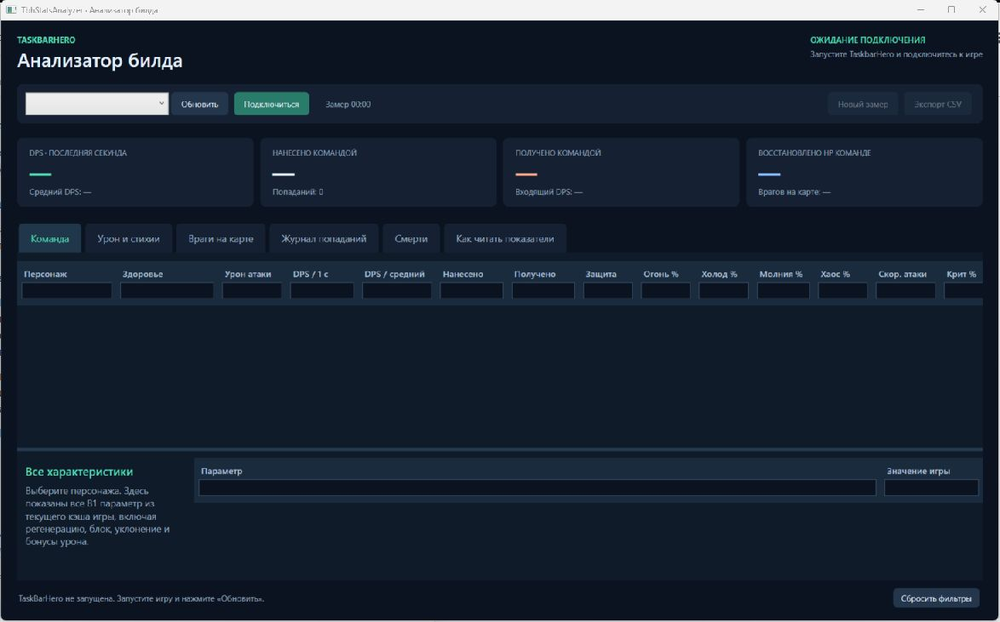

# TbhStatsAnalyzer — анализатор билда TaskbarHero

Приложение C# / WPF для Windows x64. Подключается к запущенной TaskBarHero, читает текущие параметры и собирает фактические события изменения здоровья. Сохранения, характеристики и предметы игры не изменяет.



*Главное окно до подключения к игре.*

## Запуск

Готовая сборка после выполнения `build.ps1` находится в `artifacts/TbhStatsAnalyzer/TbhStatsAnalyzer.exe`. Сохраняйте рядом все файлы этой папки, в частности `TbhObserver.payload.dll`. Нужен .NET Desktop Runtime 8 x64.

1. Запустите TaskbarHero и войдите на карту.
2. Откройте `TbhStatsAnalyzer.exe`, выберите PID и нажмите **Подключиться**.
3. Откройте вкладки **Команда**, **Урон и стихии**, **Враги на карте**, **Журнал попаданий**, **Смерти**.
4. Используйте **Новый замер** при смене билда и **Экспорт CSV** для сохранения результатов. При переходе на другую карту начинается новый замер.

Если игра запущена с повышенными правами, анализатору нужны такие же права. В обычном случае повышение не требуется. При отключении сбор прекращается; наблюдатель остаётся в памяти до завершения игры. Одновременно используйте один экземпляр анализатора для одного процесса.

## Фильтры таблиц

Под каждым заголовком столбца есть поле фильтра. Введите часть текста, например `огонь` или `рыцарь`: регистр не учитывается. Для числовых столбцов доступны условия `>1000`, `>=1000`, `<0`, `<=50`, `=0` и `!=0`. Дроби можно вводить с запятой или точкой, например `>=1,5`. Условия разных столбцов действуют одновременно; пустое поле не ограничивает строки. Ошибочное числовое условие отмечается цветом и подсказкой.

Фильтры сохраняются при обновлении данных, выборе другого персонажа, переключении вкладок и новом замере до закрытия приложения. `Esc` очищает текущее поле; кнопка **Сбросить фильтры** внизу окна очищает все таблицы. На вкладке **Урон и стихии** фильтры столбцов применяются вместе с выбранным направлением. Если подходящих строк нет, таблица остаётся пустой.

Фильтры влияют только на отображение таблиц. Общие счётчики и экспорт CSV содержат весь замер.

## Автоматические релизы

Каждый пуш в `master` запускает [workflow сборки и выпуска](.github/workflows/release.yml). На Windows x64 собираются нативный наблюдатель и WPF-приложение, выполняются обычные проверки и проверки интерфейса. После успешных проверок создаётся [релиз GitHub](https://github.com/xromen/TbhStatsAnalyzer/releases) с тегом `v1.0.N` и архивом `TbhStatsAnalyzer-v1.0.N-win-x64.zip`, где `N` — номер запуска workflow. Эта же версия записывается в сборку приложения. Секреты вручную настраивать не нужно: используется встроенный `GITHUB_TOKEN` с разрешением `contents: write`.

Неудачная сборка не публикует релиз, поэтому номера версий могут иметь пропуски. Повторный запуск того же workflow использует ту же версию и обновляет её архив. Архив содержит приложение, наблюдатель, README и лицензию MinHook; для запуска нужен .NET Desktop Runtime 8 x64.

Локальная сборка с указанной версией: `./build.ps1 -Test -Version 1.0.1`. Без параметра `-Version` используется `1.0.0`.

## Показатели

- Активная команда из `StageManager.HeroList`: HP и максимум HP, урон атаки, защита, четыре стихийных сопротивления, скорость атаки, шанс крита, нанесённый/полученный урон, восстановленное HP, текущий и средний DPS.
- Все **81 параметр StatType** выбранного героя или врага: регенерация, блок, уклонение, поглощение, бонусы стихий, урон по боссам, похищение здоровья, параметры навыков и прочее.
- Живые враги текущей волны из `MonsterSpawnManager.MonsterList` и `SummonedMonsterList`. Будущие, ещё не появившиеся волны здесь не перечисляются.
- Разбивка нанесённого и полученного урона по юниту, стихии, типу доставки и источнику. Отдельно учитываются физический урон, огонь, холод, молния, хаос; базовая атака, навык/эффект, крит и перераспределение доступны в журнале.
- Счётчики потерь событий и ошибок чтения. При ненулевом числе потерь повторите замер.
- **Смерти**: время и герой, кто добил, стихия/тип/источник смертельного удара, крит, урон и HP перед добиванием. При выборе смерти показываются разбивка по атакующим и стихиям и последовательность урона/лечения за последние 10 секунд этой жизни.

Смерть регистрируется по успешному результату игрового обработчика `Hero.hbd(Unit)`. Нулевой HP, смертельный по размеру удар и срабатывание эффекта предотвращения смерти сами по себе не создают запись. Смертельный удар связан с записью смерти по номеру события; если связанного удара нет, причина не угадывается по предыдущим атакам. Воскрешение не смешивает историю разных жизней. Разбор смерти сохраняется отдельно от общего журнала на 1000 событий.

История смертей относится к текущему замеру и очищается вместе с ним. За пропущенные события, ошибки чтения, отсутствие смертельного удара и первые 10 секунд после подключения/сброса выводится отметка «Неполная история». Смерти до подключения не восстанавливаются. CSV включает записи смертей, их разбивку и последовательности попаданий.

**DPS за 1 с** — сумма за скользящую последнюю секунду реального времени. **Средний DPS** — сумма с начала замера, делённая на всё время замера, включая паузы и ожидание волны. Статистика до подключения не восстанавливается.

**Урон** — величина изменения HP, уже рассчитанная игрой после защиты. **Потеря HP** ограничена здоровьем перед ударом; **избыток** — оставшийся урон при добивании. Полностью заблокированные, поглощённые и уклонённые атаки без изменения HP не входят в счётчик. Это не счётчик попыток атаки или поглощённого щитом урона.

`OriginDamage` в журнале — исходное поле игры, которое может не включать критический множитель и последующие модификаторы. Нельзя вычислять чистое снижение от защиты простым сравнением `OriginDamage` с итоговым уроном.

Основная таблица использует боевые getter-методы Unit: урон атаки и защита включают модификаторы; сопротивления учитывают общий стихийный бонус и игровой предел. Сопротивления отображаются в процентных пунктах, шанс крита преобразован из доли в проценты. В подробностях сначала показаны боевые показатели, затем 81 исходное значение кэша с префиксом «Кэш». Например, исходный шанс крита `0.033375` соответствует `3.3375%`. Базовые характеристики монстра в кэше могут существенно отличаться от значений после масштабирования картой.

CSV сохраняет итоги и подробные характеристики, разбивку урона и последние 1000 событий. Долгий замер не ограничен 1000 событиями: полные суммы хранятся отдельно. Разделитель CSV — `;`, дробная часть — с запятой.

## Сборка и проверки

Нужны Windows, .NET SDK 8 и Visual Studio с **Desktop development with C++** (MSVC x64 и Windows SDK). NuGet-зависимостей нет; исходники MinHook включены в репозиторий.

```powershell
.\build.ps1 -Test
```

Сборка только C# с уже скомпилированным наблюдателем:

```powershell
.\build.ps1 -SkipNative -Test
```

Проверка на запущенной игре — загружает наблюдатель и читает 12 секунд боя:

```powershell
.\tests\TbhStatsAnalyzer.Checks\bin\Release\net8.0-windows\TbhStatsAnalyzer.Checks.exe --live
```

Она сохраняет `artifacts/verification/live-snapshot.json`, `live-events.json` и `live-meter.csv`. Игра должна действительно сражаться, иначе проверка отсутствия боевых событий завершится ошибкой.

Минутная проверка регистрации смертей: добавьте `--live-deaths` вместо `--live`. Если за минуту герои не погибли, это явно видно по счётчику `deaths=0`; искусственная смерть в игре не вызывается. Дополнительно сохраняется `artifacts/verification/live-deaths.json`.

Проверка заполненной WPF-вкладки на контрольных данных без подключения к игре:

```powershell
dotnet run --project tests\TbhStatsAnalyzer.Checks -c Release -- --ui-deaths
```

Она проверяет выбор смерти, суммы, обе таблицы и ошибки привязок WPF и сохраняет `deaths-tab.png` и `death-timeline.png` в `artifacts/verification`. Обычные проверки покрывают смертельный удар, разные стихии, лечение, воскрешение, пропуски истории и предотвращение ложной регистрации смерти по одному только нулевому HP.

Проверка фильтров всех таблиц без подключения к игре:

```powershell
dotnet run --project tests\TbhStatsAnalyzer.Checks -c Release -- --ui-filters
```

Проверяет текстовые и числовые условия, сочетание столбцов, обновление данных, сортировку, выбор строк, сброс и ввод через заголовок WPF. Сохраняет `artifacts/verification/column-filters.png`.

## Как читаются данные

Классы, поля, смещения, значения перечислений и сигнатуры были найдены **установленным IL2CPP.Mcp** в процессе игры, а не подобраны вручную. Результаты исследования описаны в `docs/il2cpp-discovery.md`.

WPF-приложение самостоятельно загружает свой `TbhObserver` и общается с ним через локальный named pipe; запущенный MCP и Codex для повседневного использования не нужны. Наблюдатель разрешает смещения и адреса методов заново из IL2CPP-метаданных. Абсолютные адреса и PID исследовательской сессии не используются в коде.

MinHook наблюдает `Unit.hal` для контекста `DamageInfo`, `pp.hby` и отдельный `pl.hby` для окончательного изменения здоровья врагов и героев, `Hero.hbd(Unit)` для подтверждения смерти и `StageManager.Update` для чтения на основном потоке Unity. При несовместимых именах полей/сигнатурах возвращается ошибка. Совместимость после обновления игры нужно перепроверять; автоматическая проверка структуры не доказывает неизменность логики игры.

Пакет DLL копируется в локальный подкаталог `observer/<хеш>` рядом с приложением. Это позволяет пересобирать приложение, пока предыдущая DLL загружена в игру. Локальный канал доступен только текущему пользователю и не принимает удалённых клиентов. Не подключайте к одному процессу разные версии анализатора одновременно.

Проверено на живой Unity `6000.0.72.12005885`: 3 героя, 18 врагов и 104 события за 12 секунд; ошибок и потерь не было. В образце наблюдались физические атаки ближнего боя и снаряды, входящие физический урон и молния, 23 события восстановления HP. Команда получила 2917.097 урона и восстановила 4204.576 HP. Формулы DPS дополнительно проверены тестами; все пять стихий в этом живом образце не встретились.

Вкладка смертей дополнительно проверена на реальном бою: в работающем приложении зарегистрированы Рыцарь (физический удар Лучника снежной горы), Жрец (физический удар Деревянного человека) и Следопыт (огонь Пылающего жреца ада и Дракончика). Для Следопыта смертельный удар Пылающего жреца составил 2269.68 при 1316.86 HP до попадания; за предшествующие 10 секунд зарегистрированы 4484.005 урона и 2214.325 лечения. История была полной; ошибок и потерь не было.

## Источники и лицензии

- Поиск игровых данных: [IL2CPP.Mcp — takiy_veshi](https://t.me/takiy_veshi). Исходные бинарники MCP в проект не включены.
- Перехват вызовов: [MinHook 1.3.4 — Tsuda Kageyu](https://github.com/TsudaKageyu/minhook/tree/v1.3.4), BSD-2-Clause. Лицензия: `native/vendor/minhook/LICENSE.txt`; копируется в сборку.
- [Описание WPF-проекта в документации Microsoft](https://learn.microsoft.com/en-us/dotnet/core/project-sdk/msbuild-props-desktop).
